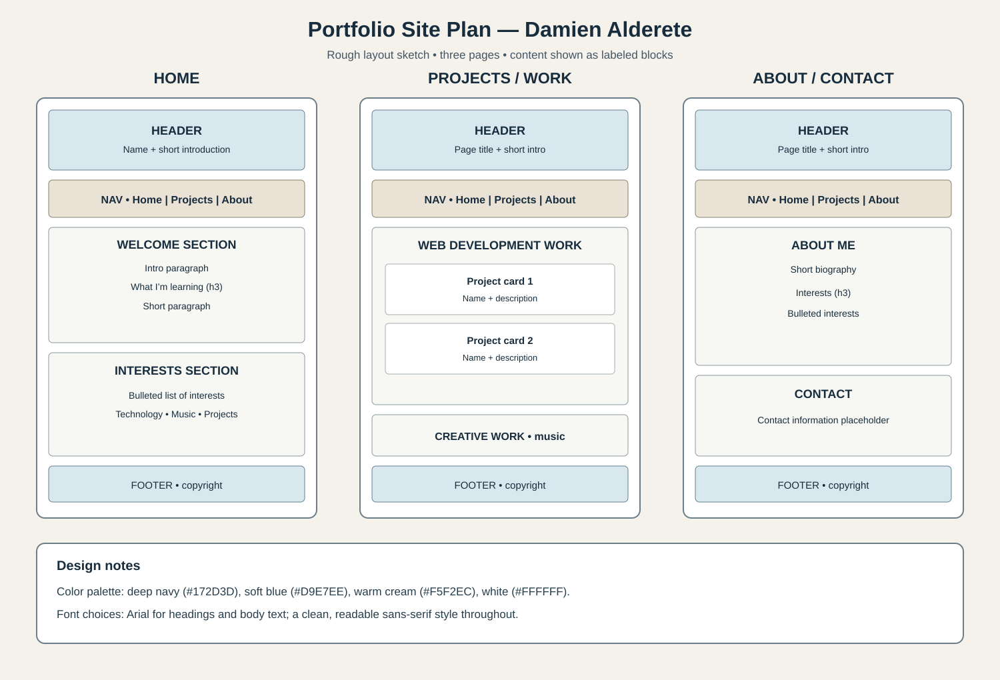

# Damien Alderete's Portfolio Plan

This folder contains the three-page HTML portfolio, its shared CSS stylesheet, and the wireframe plan.

## Wireframe

## Pages

All three pages load the shared `style.css` file. The stylesheet uses type, class, and ID selectors and demonstrates padding, borders, and margins on the header, project cards, and footer.

- [Home](index.html)
- [Projects / Work](projects.html)
- [About / Contact](about.html)

## Design notes

- **Colors:** deep navy (`#172D3D`), soft blue (`#D9E7EE`), warm cream (`#F5F2EC`), and white (`#FFFFFF`).
- **Fonts:** Arial for headings and body text, using a readable sans-serif style.

- [Stylesheet](style.css)
